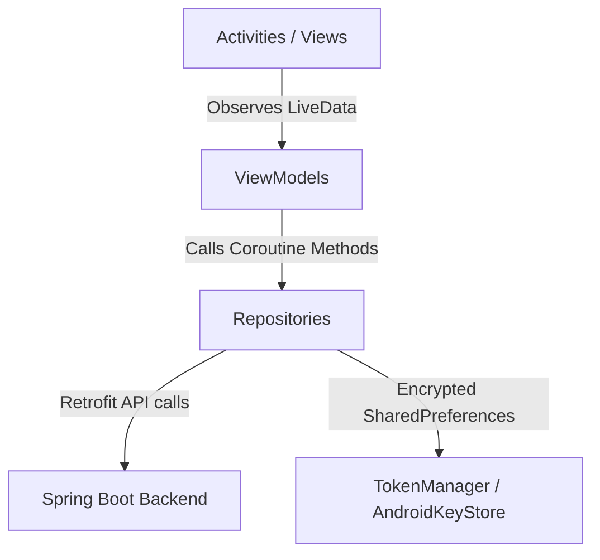

# Android Documentation — Bourse

## 1. Application Overview
**VERIFIED FROM ANDROID SOURCE**: Bourse is a trading simulation Android client application designed to allow users to simulate equity trading, monitor portfolio performance, analyze stock price charts, and manage account preferences. 

### Main User Flows
1. **Onboarding / Authentication**: Splash launch (`SplashActivity`) → Login/Register (`LoginActivity` / `SignupActivity`) → Transaction PIN Setup (for new accounts) → Main Dashboard (`MainActivity`).
2. **Dashboard / Home**: View portfolio valuation, cash balance, invested value, filtered recent activity, and quick trading actions.
3. **Market Exploration**: Browse available stocks (`MarketActivity`), search by symbol/company name, view price trends and percentage changes.
4. **Stock Details & Trading**: Inspect stock details (`StockDetailsActivity`), analyze historical price trend charts (MPAndroidChart), specify quantities to trade, authenticate with the secure 4-digit Transaction PIN, and execute `BUY` or `SELL` orders.
5. **Portfolio & Holdings**: View total holdings, individual stock performance, recommendations, and transaction history.
6. **Profile & Security**: Manage personal info, change Transaction PIN, toggle app themes (System, Light, Dark), and log out (`ProfileActivity`).

## 2. Technology Stack

| Technology | Version | Purpose | Where Used |
|---|---|---|---|
| Kotlin | Gradle configured | Primary programming language | Entire codebase |
| Android SDK / Material 3 | API 26+ (Target 37) | UI components, styling, themes | XML layouts & Views |
| ViewBinding | AGP 9.4.1 | Type-safe view inflation and binding | All Activities & Dialogs |
| Retrofit | 2.9.0 | REST API client | Network communication |
| OkHttp | 4.11.0 | HTTP transport & Logging | Network interceptors (`AuthInterceptor`, `HttpLoggingInterceptor`) |
| Gson | 2.10.1 | JSON serialization/deserialization | DTO mapping & `TimestampDeserializer` |
| MPAndroidChart | 3.1.0 | Interactive stock price history chart | `StockDetailsActivity` |
| Kotlin Coroutines | 1.8.1 | Asynchronous operations & threading | Repositories & ViewModels |
| AndroidX Lifecycle / LiveData | 2.8.7 | Lifecycle-aware state management | ViewModels & UI Observers |
| AndroidKeyStore | System SDK | Cryptographic key management | `TransactionPinStore` |
| SharedPreferences | Android SDK | Key-value secure storage | `TokenManager`, `TransactionPinStore` |

## 3. Android Project Structure
```text
app/
├── src/
│   └── main/
│       ├── java/ind/finance/bourse/
│       │   ├── data/
│       │   │   ├── local/      # TokenManager, TransactionPinStore
│       │   │   ├── model/      # DTOs, Requests, Responses, Models
│       │   │   └── remote/     # ApiClient, Retrofit Services, Interceptors, TimestampDeserializer
│       │   ├── repository/     # UserRepository, PortfolioRepository, StockRepository, TradingRepository
│       │   ├── ui/             # ViewModels by feature
│       │   ├── Activities      # Splash, Login, Signup, Main, Market, StockDetails, Portfolio, Transactions, Profile, AllHoldings
│       │   └── Adapters        # StockAdapter, TransactionAdapter
│       ├── res/                # XML layouts, drawables, values, colors, themes
│       └── AndroidManifest.xml
```

## 4. Architecture
**VERIFIED FROM ANDROID SOURCE**: The application implements the **Model-View-ViewModel (MVVM)** architectural pattern combined with the **Repository Pattern** and ViewBinding. Dependencies are manually instantiated in ViewModels and Activities rather than via DI frameworks like Hilt or Dagger.



## 5. Application Flow
```text
App Launch (SplashActivity)
    ↓
Check JWT Token in TokenManager
    ├─► Token Exists → MainActivity (Home)
    └─► No Token → LoginActivity
                        ↓
                 Successful Login / Register
                        ↓
                 Check Transaction PIN (TransactionPinStore)
                        ├─► PIN Exists → MainActivity (Home)
                        └─► No PIN → Set Transaction PIN Dialog → MainActivity (Home)
```
